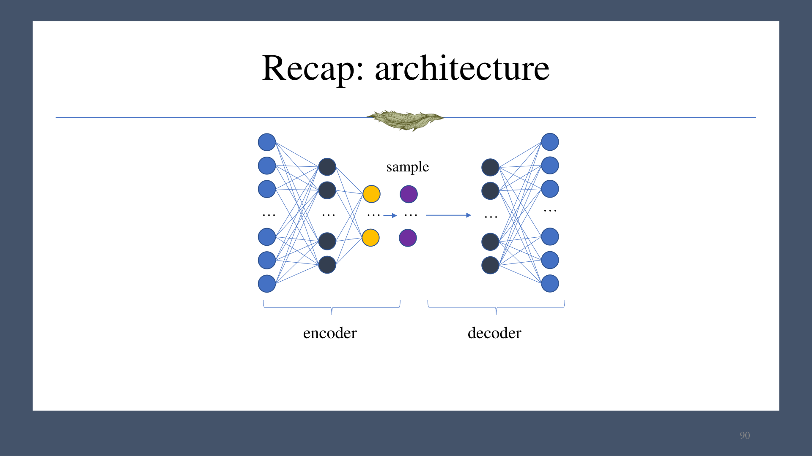
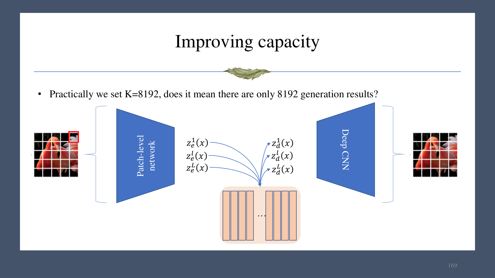
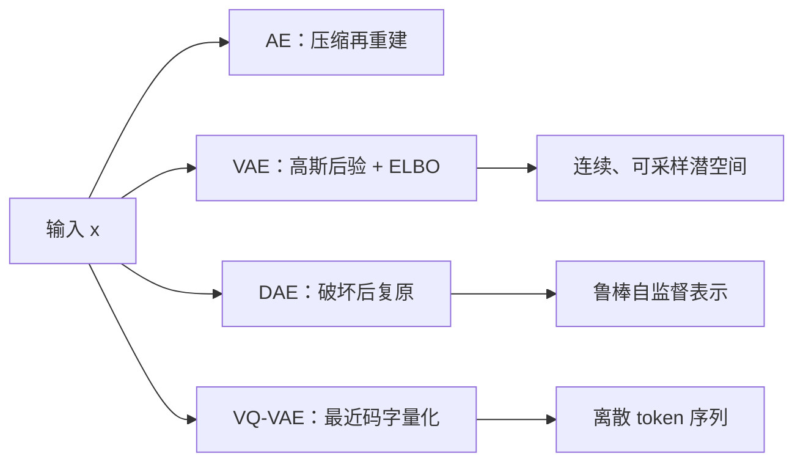

# 第 03 章　自编码器、VAE、DAE 与 VQ-VAE

> 来源版本：2026-11-09 教学网核验版。原有图片及其“原课件页码”沿用旧版来源；以下新增说明明确标出新版页码。
## 1. 自编码器（Autoencoder）

自编码器由编码器 $g$ 和解码器 $f$ 组成：

```math
h=g(x),\qquad \hat x=f(h),\qquad f(g(x))\approx x.
```

若网络容量不受限制，它可能直接学习恒等映射。为迫使模型抽取结构，通常令潜表示 $h$ 经过低维瓶颈，或加入噪声、稀疏性等约束。自编码器可用于可视化、压缩、无监督表示学习和预训练。

### 1.1 线性自编码器与 PCA

设数据 $x\in\mathbb R^d$，潜维度 $k\ll d$：

```math
h=Ux,\qquad \hat x=Vh=VUx,
```

其中 $U\in\mathbb R^{k\times d}$，$V\in\mathbb R^{d\times k}$。训练目标为

```math
\min_{U,V}\lVert VUX-X\rVert_F^2.
```

该分解存在尺度/基变换不唯一性：对任意可逆矩阵 $A$，$(AU,A^{-1}V)$ 给出同一乘积。在线性、平方误差和秩约束下，最优子空间与 PCA 的主子空间一致，并可由闭式特征分解求得。

### 1.2 为什么普通自编码器不是生成模型

普通自编码器只保证训练样本能编码再重建，并未规定潜变量 $h=g(x)$ 的整体分布。随机取一个 $h$ 往往落在训练编码未覆盖的区域，解码结果不可控。因此，若要生成，还需要为潜空间指定可采样的分布并让编码分布与之对齐。

## 2. 变分自编码器（VAE）

VAE 把编码器改为近似后验 $q_\phi(z\mid x)$，把解码器解释为似然 $p_\theta(x\mid z)$，并指定简单先验 $p(z)=\mathcal N(0,I)$。常用对角高斯编码器：

```math
q_\phi(z\mid x)=\mathcal N\!\left(z;\mu_\phi(x),\mathrm{diag}(\sigma_\phi^2(x))\right).
```



以课件中的 MNIST 示例为例，输入为 $28\times28=784$ 维，隐藏层可取 256 维，编码器输出 50 个均值和 50 个方差参数。编码器与解码器不必镜像，也不局限于 MLP。

### 2.1 重参数化技巧

直接写 $z\sim q_\phi(z\mid x)$ 会把随机采样节点置于从损失到编码器参数的梯度路径上。将随机性移到与参数无关的噪声：

```math
\epsilon\sim\mathcal N(0,I),\qquad
z=\mu_\phi(x)+\sigma_\phi(x)\odot\epsilon.
```

此时 $z$ 对 $\mu_\phi,\sigma_\phi$ 可微，可以用普通反向传播优化编码器。实践中网络常输出 $\log\sigma^2$，以保证方差为正并改善数值稳定性。

### 2.2 从边缘似然到 ELBO

生成模型为

```math
p_\theta(x)=\int p_\theta(x\mid z)p(z)\,dz,
```

该积分通常不可解。新版课件第 106–110 页用“给定样本仅在部分潜变量区域有较大贡献”帮助理解积分难度，并明确标注这只是直觉、并非普遍成立的结论。高斯密度一般不会在其余区域严格为零，不能据此把积分精确截断。

引入编码器给出的近似后验 $q_\phi(z\mid x)$，可以得到 ELBO 分解。这里需要区分三个分布：

- $p(z)$ 是生成模型指定的先验，通常为标准正态；
- $p_\theta(z\mid x)$ 是看到 $x$ 后的真实后验，通常难以直接计算；
- $q_\phi(z\mid x)$ 是编码器给出的近似后验，用来逼近真实后验。

下面固定一个样本 $x$，将 $\mathbb E_{q_\phi(z\mid x)}$ 简写为 $\mathbb E_q$。推导的关键是贝叶斯公式和 KL 散度的定义。

先由贝叶斯公式写出真实后验：

```math
p_\theta(z\mid x)
=\frac{p_\theta(x\mid z)p(z)}{p_\theta(x)}.
```

两边取对数，得到

```math
\log p_\theta(z\mid x)
=\log p_\theta(x\mid z)+\log p(z)-\log p_\theta(x).
```

再从近似后验与真实后验之间的 KL 出发，代入上式：

```math
\begin{aligned}
D_{\mathrm{KL}}\!\left(q_\phi(z\mid x)\,\|\,p_\theta(z\mid x)\right)
&=\mathbb E_q\!\left[
\log q_\phi(z\mid x)-\log p_\theta(z\mid x)
\right]\\
&=\mathbb E_q\!\left[
\log q_\phi(z\mid x)-\log p(z)
\right]\\
&\quad-\mathbb E_q[\log p_\theta(x\mid z)]
+\log p_\theta(x)\\
&=D_{\mathrm{KL}}\!\left(q_\phi(z\mid x)\,\|\,p(z)\right)
-\mathbb E_q[\log p_\theta(x\mid z)]
+\log p_\theta(x).
\end{aligned}
```

其中 $x$ 已固定，$\log p_\theta(x)$ 与期望中的变量 $z$ 无关；由于 $\int q_\phi(z\mid x)\,dz=1$，所以 $\mathbb E_q[\log p_\theta(x)]=\log p_\theta(x)$。第一组期望则正好是 $D_{\mathrm{KL}}(q_\phi(z\mid x)\|p(z))$。

将上式移项，并把“重建期望减去与先验的 KL”定义为 $\mathcal L_{\text{ELBO}}(x)$，就得到

```math
\begin{aligned}
\log p_\theta(x)
&=\mathcal L_{\text{ELBO}}(x)
+D_{\mathrm{KL}}\!\left(q_\phi(z\mid x)\,\|\,p_\theta(z\mid x)\right),\\
\mathcal L_{\text{ELBO}}(x)
&=\mathbb E_{q_\phi(z\mid x)}[\log p_\theta(x\mid z)]
-D_{\mathrm{KL}}\!\left(q_\phi(z\mid x)\,\|\,p(z)\right).
\end{aligned}
```

这个分解是精确恒等式。KL 非负，因此 ELBO 是 $\log p_\theta(x)$ 的下界；当近似后验与真实后验一致时，二者之间的 KL 为零，下界取到等号。

注意两个 KL 的作用不同：$D_{\mathrm{KL}}(q_\phi(z\mid x)\|p_\theta(z\mid x))$ 是 ELBO 与对数边缘似然之间的差距，衡量后验近似误差；$D_{\mathrm{KL}}(q_\phi(z\mid x)\|p(z))$ 则是 ELBO 内部的正则项，约束编码分布接近先验。

最大化 ELBO 在下面两个目标之间做权衡，并不保证每次参数更新都让两项同时改善：

- 提高重建项，使 $z$ 能解释 $x$；
- 减小近似后验与先验的 KL，鼓励编码分布与可采样的先验对齐。

对角高斯到标准正态的 KL 可以先从一维情况推导。固定样本 $x$，省略编码分布对 $x$ 和参数 $\phi$ 的依赖，记 $q(z)=\mathcal N(z;\mu,\sigma^2)$、$p(z)=\mathcal N(z;0,1)$，其中 $\sigma>0$。

首先写出两个高斯的概率密度：

```math
q(z)=\frac{1}{\sqrt{2\pi\sigma^2}}
\exp\!\left(-\frac{(z-\mu)^2}{2\sigma^2}\right),
\qquad
p(z)=\frac{1}{\sqrt{2\pi}}
\exp\!\left(-\frac{z^2}{2}\right).
```

密度相除时，归一化系数相除，指数部分相减：

```math
\begin{aligned}
\frac{q(z)}{p(z)}
&=\frac{\sqrt{2\pi}}{\sqrt{2\pi\sigma^2}}
\exp\!\left(
-\frac{(z-\mu)^2}{2\sigma^2}-\left(-\frac{z^2}{2}\right)
\right)\\
&=\frac{1}{\sqrt{\sigma^2}}
\exp\!\left(-\frac{(z-\mu)^2}{2\sigma^2}+\frac{z^2}{2}\right).
\end{aligned}
```

再利用 $\log(ab)=\log a+\log b$、$\log(e^a)=a$ 和 $\log((\sigma^2)^{-1/2})=-\tfrac12\log\sigma^2$，得到

```math
\log\frac{q(z)}{p(z)}
=-\frac12\log\sigma^2
-\frac{(z-\mu)^2}{2\sigma^2}
+\frac{z^2}{2}.
```

其中第一项来自归一化系数，最后一项为正，是因为相除时要减去 $p(z)$ 中原本为负的指数 $-z^2/2$。

按照 KL 的定义，还需要在 $q$ 下取期望。由高斯的均值与方差可知

```math
\mathbb E_q[(z-\mu)^2]=\sigma^2,
\qquad
\mathbb E_q[z^2]
=\mathrm{Var}_q(z)+(\mathbb E_q[z])^2
=\sigma^2+\mu^2.
```

因此一维 KL 为

```math
\begin{aligned}
D_{\mathrm{KL}}(q\|p)
&=\mathbb E_q\!\left[\log\frac{q(z)}{p(z)}\right]\\
&=-\frac12\log\sigma^2
-\frac{\sigma^2}{2\sigma^2}
+\frac{\sigma^2+\mu^2}{2}\\
&=\frac12\left(\mu^2+\sigma^2-\log\sigma^2-1\right).
\end{aligned}
```

对于多维对角高斯 $q_\phi(z\mid x)=\prod_j q_j(z_j)$，标准正态先验同样满足 $p(z)=\prod_j p_j(z_j)$。乘积的对数变成求和，因此整体 KL 等于各维 KL 之和：

```math
D_{\mathrm{KL}}(q_\phi(z\mid x)\|\mathcal N(0,I))
=\frac12\sum_j\left(\mu_j^2+\sigma_j^2-\log\sigma_j^2-1\right).
```

若把重建项写成均方误差，一个常见最小化形式为

```math
\mathcal L_{\text{VAE}}
=\mathcal L_{\text{rec}}(x,\hat x)
+\lambda D_{\mathrm{KL}}(q_\phi(z\mid x)\|p(z)).
```

$\lambda$ 调节重建质量与潜空间规则性。训练后生成时不需要编码器：采样 $z\sim\mathcal N(0,I)$，再由 $p_\theta(x\mid z)$ 解码。

### 2.3 局限

- 深层 VAE 的优化较难；
- 潜维度和 KL 权重较敏感；
- 优化的是似然下界，而非直接精确计算边缘似然；
- 实际系统中常作为更大生成管线的表示或压缩组件。

## 3. 去噪自编码器（DAE）

DAE 先从干净样本 $x$ 构造受损输入 $\tilde x\sim c(\tilde x\mid x)$，再学习还原 $x$：

```math
\min_\theta\;\mathbb E_{x,\tilde x}\bigl[\ell(f_\theta(\tilde x),x)\bigr].
```

因为输入与目标不同，恒等映射不再是零损失捷径。破坏方式可以是遮蔽、删除或加性噪声；结构上不一定显式分成编码器和解码器。BERT 的掩码语言建模和 MAE 的图像块遮蔽都属于这一思想。它适合大规模自监督预训练与缺失内容恢复，但通常不单独称为完整的生成模型。

## 4. 向量量化 VAE（VQ-VAE）

VQ-VAE 用有限码本把连续视觉特征变为离散 token。设编码器输出 $z_e(x)$，码本为

```math
\mathcal E=\{e_k\}_{k=1}^{K}.
```

对每个空间位置选择最近码字：

```math
k^{\ast}=\arg\min_k\lVert z_e(x)-e_k\rVert_2,
\qquad z_q(x)=e_{k^{\ast}}.
```

> 2026-11-09 核对教学网新版第 156、159 页，课件已将最近码字选择修正为 `argmin`。本笔记原有公式正确，旧版 `argmax` 的勘误说明据此更新。

最近邻选择不可微。直通估计器写成

```math
z_{\text{st}}=z_e+\mathrm{sg}(z_q-z_e),
```

其中 $\mathrm{sg}$ 表示停止梯度。前向数值等于 $z_q$，反向对 $z_e$ 的导数视为恒等映射。

典型损失为

```math
\mathcal L
=\underbrace{\lVert x-D(z_q)\rVert_2^2}_{\text{重建}}
+\underbrace{\lVert\mathrm{sg}[z_e]-e\rVert_2^2}_{\text{更新码本}}
+\underbrace{\beta\lVert z_e-\mathrm{sg}[e]\rVert_2^2}_{\text{commitment}}.
```

最后一项防止编码器输出任意漂移，迫使其靠近所选码字。



码本大小 $K=8192$ 并不意味着只能生成 8192 种图像。图像被编码为长度 $L$ 的 token 序列，理论组合数为 $K^L$；后续可再用自回归模型或其他先验学习这些离散序列的分布。

## 5. 小结


