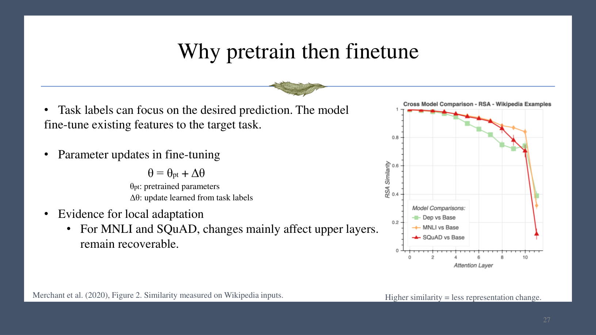
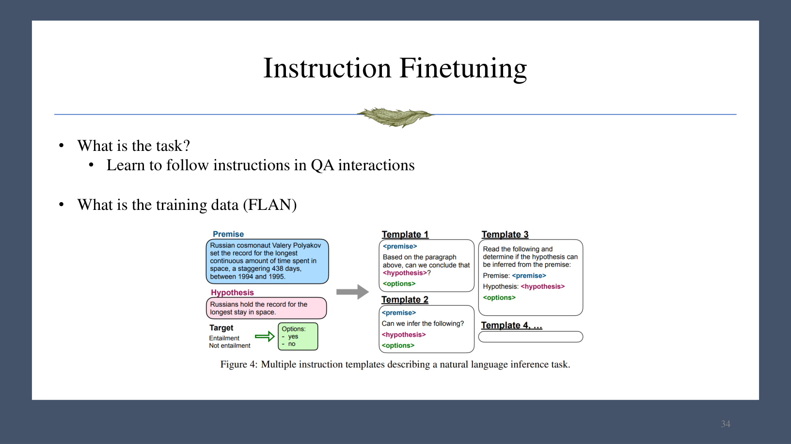
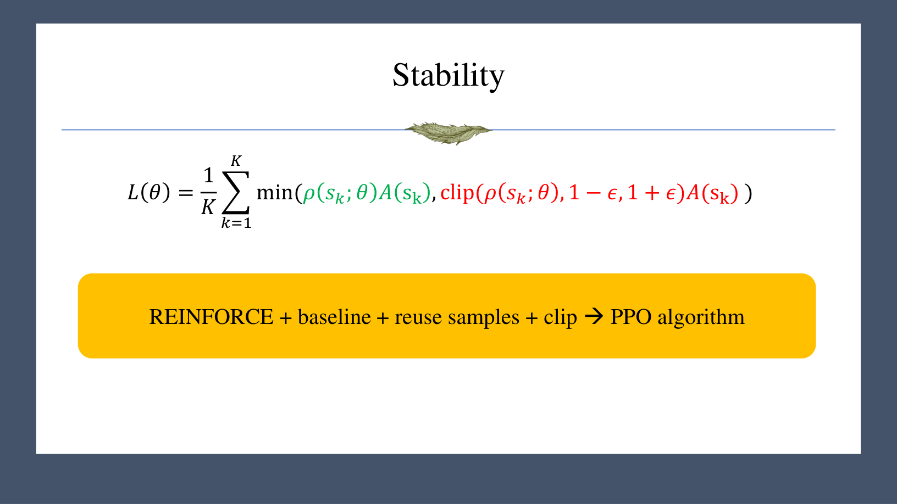
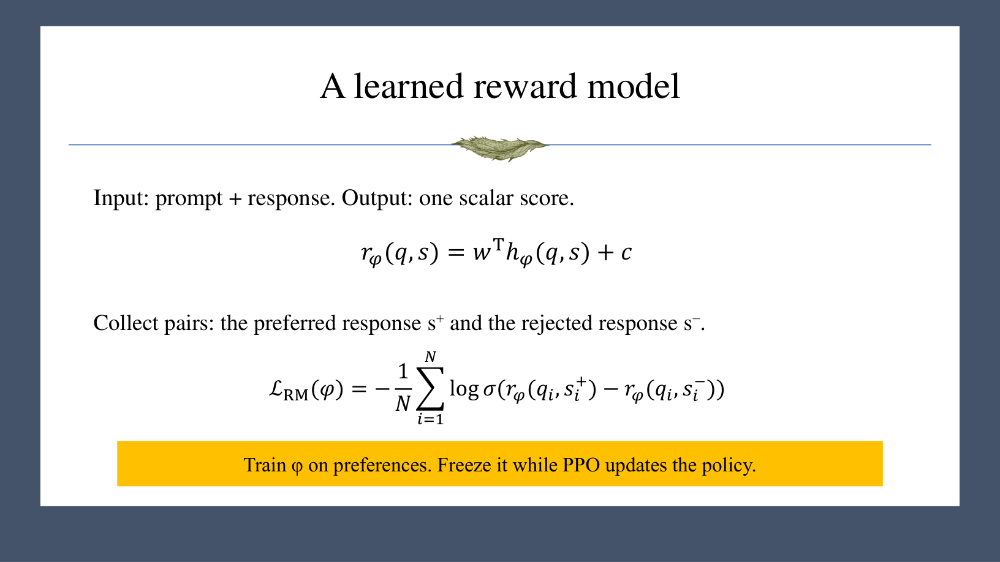
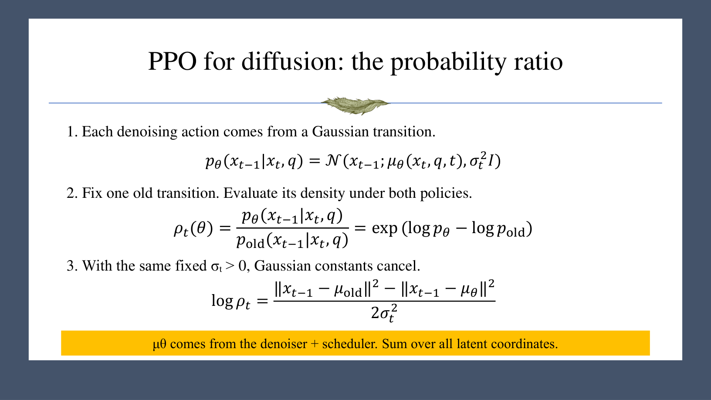
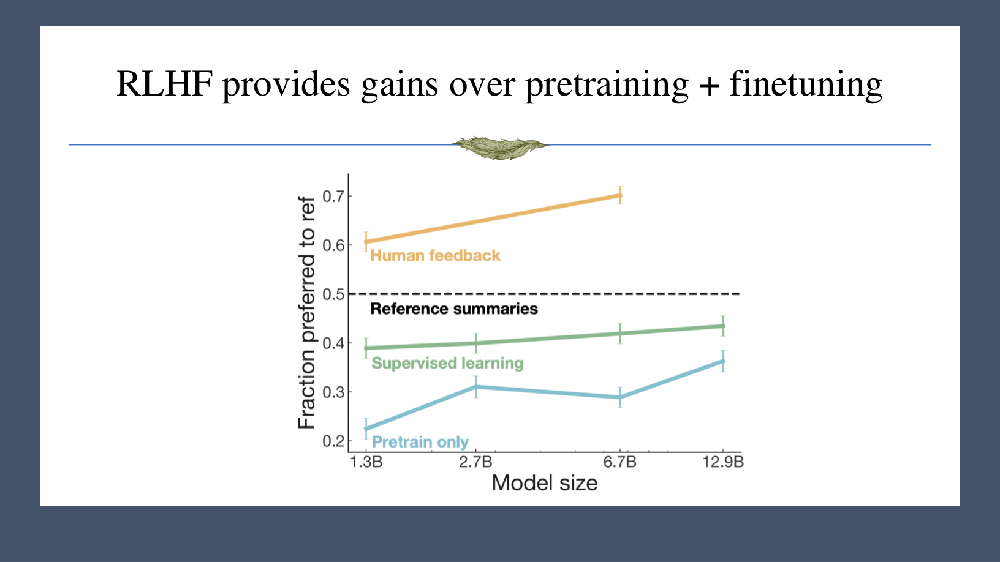

# 第 7 章　微调、指令学习与 RLHF

预训练让模型学会文本分布，指令微调让它按任务格式回答，强化学习则用对完整输出的评价调整生成概率。本章的主线是：**复用预训练知识 → 指令监督 → 序列奖励 → REINFORCE → 基线 → 复用采样 → PPO**。

来源：教学网《Finetuning》，PDF 140 页。下文页码均指 PDF 物理页；动画重复页合并，公式使用统一记号。未做训练或复现实验。标为“补充解释”的内容用于澄清推导条件，不作为课件新增实验结论。

## 1. 为什么预训练之后还要微调

### 1.1 语言建模不等于帮助用户（第 2—13 页）

自回归语言模型学习

```math
p_\theta(x_1,\ldots,x_T)=\prod_{t=1}^{T}p_\theta(x_t\mid x_{\lt t}).
```

这首先是一种续写能力。给模型“登月是……”的开头，它可以继续百科文章；给它“用几句话向六岁孩子解释登月”，合适的行为却是回答问题，而不是继续列出类似问题。课件展示的未对齐模型正会出现后者。

网页语料多是文章、书籍、代码和论文，规模大但有噪声；聊天数据是问答交互，规模相对小，却要求利用大量知识。这带来三个不同问题：

1. 如何把预训练中学到的知识迁移到任务？用微调适配参数。
2. 如何使模型遵循对话格式和指令？用指令微调。
3. 如何让完整回答符合任务效果和人的偏好？引入序列级反馈。

三者不能混同。能按格式作答，不代表事实正确；下一个词预测得好，也不自动保证整个回答有用。

### 1.2 从逐任务监督到“预训练—微调”（第 16—27 页）

传统监督学习为每个任务准备 $D=\{(x_i,y_i)\}_{i=1}^N$，学习 $p_\theta(y\mid x)$。例如输入影评、输出正负情感。任务、语言和使用场景太多，逐一收集足够标签代价高；标签少又容易过拟合。

BERT 提供了通用范式：先在海量未标注文本上做掩码词预测，再从同一预训练参数初始化不同下游模型。其预训练可理解为去噪自编码；不能把 BERT 的掩码目标直接等同于自回归生成目标。

若预训练参数为 $\theta_{\mathrm{pt}}$，下游优化是

```math
\min_\theta\frac1N\sum_{i=1}^N\ell(f_\theta(x_i),y_i),
\qquad\theta\leftarrow\theta_{\mathrm{pt}}\quad\text{作为初始化}.
```

写成 $\theta=\theta_{\mathrm{pt}}+\Delta\theta$，强调微调是在已有表示和知识上适配，而非重新从随机参数学习。预测缺失词或下一个词需要理解上下文：天空的颜色涉及事实，雨天撑伞涉及常识，两颗糖涉及简单数量关系。但这只是解释预训练为什么有帮助，不保证模型真正学会所有推理规则。



图中不同任务的曲线说明微调可能更多改变高层表示；这不是“底层永远不变”的定理，也不意味着默认必须冻结底层。课件引用 Merchant 等（2020）图 2，展示 MNLI、SQuAD 等任务的现象。

课件第23页列出 BERT Large 的历史示例：SWAG 为 86.3%，相对表中此前结果 52.7% 高 33.6 个百分点；SQuAD 2.0 为 83.1 F1，相对 62.3 F1 高 20.8 F1。这里保留的是讲义中的历史对比，不将它解释为相同训练数据与算力条件下对单一机制的消融。

## 2. 指令微调（第 28—43 页）

### 2.1 数据发生了什么变化

指令微调把已有标注任务写成自然语言指令和目标回答。例如，同一个自然语言推断样本可以有多种问法：判断两句话是否矛盾、是否可以推出结论，或选择最合适的标签。FLAN 的关键做法之一，就是把既有任务数据转成多种指令模板。



模板不是装饰。模型必须从指令中识别“本次要做什么”，而不仅是记住一个固定输入格式。不过，多模板本身不保证对任意新任务泛化，效果还受任务覆盖、数据质量与评测方式影响。

### 2.2 目标函数与训练过程

初始化于预训练检查点，以较小学习率优化下一个 token 的预测。对指令 $q$ 与目标回答 $s=(s_1,\ldots,s_T)$，通常可写为

```math
\mathcal L_{\mathrm{SFT}}(\theta)
=-\mathbb E_{(q,s)\sim D}\sum_{t=1}^{T}
\log p_\theta(s_t\mid q,s_{\lt t}).
```

这仍是 teacher forcing：训练时条件中使用真实前缀，而不是让每个前缀都由模型自己生成。每个目标 token 都有直接监督信号。实际实现是否对提示词也计算损失取决于数据管线；上式采用只监督回答的常见写法，不声称课件规定了唯一掩码方案。

持续预训练常使用领域文本；指令微调使用任务示例。两者都可能用下一词损失，因此指令微调可广义看作一种继续训练，但二者数据组织、监督用途不同。

课件第42—43页以代词指代题展示：微调前模型继续复述题目或选项，微调后给出答案及解释。这是具体输出示例，不是可用于推断普遍正确率的统计实验。

## 3. 为什么还需要对齐（第 44—67 页）

不合预期的回答可能来自任务太难，也可能来自多个答案都“成立”但用户只偏好其中一种。训练语料噪声，以及 token 级似然与完整回答质量之间的差距，也会造成错位。

设提示为 $q$，回答为 $s\sim p_\theta(\cdot\mid q)$，完整回答的奖励为 $R(q,s)\in\mathbb R$，数值越大越好。课件用摘要示例说明：同一文档下，一个准确摘要得 8 分，另一个失真摘要得 2 分。奖励可以由人评价，也可以由训练好的模型或规则给出。

希望提高的是期望奖励：

```math
J(\theta)=\mathbb E_{q\sim D}\mathbb E_{s\sim p_\theta(\cdot\mid q)}[R(q,s)].
```

难点不只是“没有奖励梯度”。输出 token 是离散采样结果，不能直接通过普通链式法则把 $\partial R/\partial s$ 沿采样操作传回参数。策略梯度通过改变各输出的概率解决这个问题，不需要奖励函数对输出可微。

## 4. REINFORCE：从期望奖励推导梯度（第 68—88 页）

为简化记号，先固定 $q$，写 $p_\theta(s)$ 和 $R(s)$。假定奖励在本次策略更新中固定，并允许交换求导与求和：

```math
\begin{aligned}
\nabla_\theta J(\theta)
&=\nabla_\theta\sum_s p_\theta(s)R(s)\\
&=\sum_s\nabla_\theta p_\theta(s)R(s)\\
&=\sum_s p_\theta(s)\nabla_\theta\log p_\theta(s)R(s)\\
&=\mathbb E_{s\sim p_\theta}[R(s)\nabla_\theta\log p_\theta(s)].
\end{aligned}
```

核心恒等式是 $\nabla p=p\nabla\log p$，通常称为 log-derivative trick。它把“对采样分布的期望求导”转成可用样本估计的梯度。

从当前策略采样 $K$ 个回答，得到

```math
\widehat g=\frac1K\sum_{k=1}^K R(s_k)\nabla_\theta\log p_\theta(s_k),
\qquad\theta\leftarrow\theta+\alpha\widehat g.
```

这是**梯度上升**。正奖励样本对提高自身对数概率有正向贡献，负奖励相反；参数共享意味着不能据此保证每条样本概率在整体更新后都单调变化。

### 4.1 自动微分实现的符号与断梯度

可以最大化采样后的代理目标

```math
\widehat L_{\mathrm{RF}}(\theta)
=\frac1K\sum_k\log p_\theta(s_k)\,\mathrm{stopgrad}(R(s_k)).
```

若优化器默认最小化，则使用 $-\widehat L_{\mathrm{RF}}$。奖励应视为固定系数，不能把奖励模型的计算图意外接入策略梯度。

**补充解释：序列概率。** 自回归模型有

```math
\log p_\theta(s\mid q)=\sum_{t=1}^{T}\log p_\theta(s_t\mid q,s_{\lt t}).
```

应在 log 空间求和，正确屏蔽 padding，并明确是否包含终止 token；不能把整条序列概率直接连乘后再取对数。若把 token 求和换成按长度平均，实际上改变了不同长度回答的权重，需要明确这是额外设计而非等价实现。

## 5. 基线与优势：比较“相对好坏”（第 89—99 页）

若两个回答奖励分别为 2 和 5，原始 REINFORCE 对两者都有正向贡献。取基线 $b=3$，定义优势

```math
A(q,s)=R(q,s)-b(q),
```

就得到 $A_1=-1$、$A_2=2$，使更新表达相对质量。

对固定提示，若基线不依赖本次采样动作，

```math
\mathbb E_{s\sim p_\theta}[b(q)\nabla_\theta\log p_\theta(s\mid q)]
=b(q)\nabla_\theta\sum_s p_\theta(s\mid q)=0.
```

因此用 $A$ 替代 $R$ 不改变真实期望梯度；合理选择基线可降低方差。并非任意基线都会降低方差，且该证明不适用于任意依赖当前回答的基线。

**补充解释：同批均值的细节。** 若用包含样本自身奖励的同批均值作为基线，不能直接套用“与该动作独立”的证明。在独立同分布且同一提示的简化情形，中心化梯度的期望会出现 $(K-1)/K$ 的缩放；留一均值可避免这项自身相关。课件后续使用 centered rewards 作为简化算法说明，实际实现应说明基线的计算方法，而非笼统宣称任意中心化都严格无偏。

## 6. 复用旧样本与重要性采样（第 100—122 页）

生成长回答可能比一次参数更新更昂贵，因此希望同一批回答更新多次。但第一次更新后，采样分布已经不是当前策略。

保存旧策略 $p_{\mathrm{old}}$，从它采样 $s_k$；更新时固定回答、奖励、基线和旧概率。定义

```math
\rho_\theta(s)=\frac{p_\theta(s)}{p_{\mathrm{old}}(s)}.
```

例如旧概率 0.2、新概率 0.3，比例为 1.5。若旧分布在所需样本上具有支持，则

```math
\mathbb E_{s\sim p_\theta}[A(s)\nabla\log p_\theta(s)]
=\mathbb E_{s\sim p_{\mathrm{old}}}
[\rho_\theta(s)A(s)\nabla\log p_\theta(s)].
```

推导仅需在求和中乘除 $p_{\mathrm{old}}(s)$。这校正了采样分布，不等于保证有限样本估计低方差；新旧分布差异大时估计会非常不稳定。

### 6.1 正确的可微代理目标

对固定旧样本，最大化

```math
\widehat L_{\mathrm{IS}}(\theta)=\frac1K\sum_k\rho_\theta(s_k)A_k.
```

因为旧概率固定，

```math
\nabla_\theta\rho_\theta(s)
=\rho_\theta(s)\nabla_\theta\log p_\theta(s).
```

只让分子参与优化。若把 $\rho A\log p$ 作为代理目标，同时又让 $\rho$ 和 $\log p$ 都参与反向传播，会多出一项，不再是希望实现的梯度。实现时应直接使用 $\rho A$，或在采用其他等价梯度构造时明确断开哪些量。

## 7. PPO：限制过度利用旧批次（第 123—130 页）

### 7.1 为什么还要裁剪

若一个罕见回答的概率从 0.01 升至 0.10，则 $\rho=10$。比例过大时，少量样本可能主导更新，旧样本上的收益也未必能代表新策略的实际收益。

课件先用单独裁剪引出思路，再给出最终的 PPO clipped objective：

```math
L^{\mathrm{CLIP}}(\theta)=\frac1K\sum_k
\min\left(\rho_k A_k,
\mathrm{clip}(\rho_k,1-\epsilon,1+\epsilon)A_k\right).
```



这里的 $\min$ 不可省略：

- $A_k>0$ 时，希望提高概率，但超过 $1+\epsilon$ 后，不再因继续提高而获得额外代理收益。
- $A_k\lt 0$ 时，希望降低概率，但低于 $1-\epsilon$ 后，不再因继续降低而获得额外代理收益。
- 对不利方向，未裁剪项仍会保留惩罚。

**补充算例。** 令 $\epsilon=0.2$。若 $A=2,\rho=1.5$，两项分别是 3 与 2.4，取 2.4；若 $A=-2,\rho=0.5$，两项分别是 −1 与 −1.6，取 −1.6。两种情况下都限制“已经走得足够远的有利方向”。

裁剪的是优化目标中的激励，不是直接把参数更新或所有真实概率比硬性限制在区间内，也不是严格的 KL 距离保证。

### 7.2 简化 PPO 的完整循环

1. 从当前策略复制旧策略，采样 $K$ 个回答。
2. 计算奖励和固定优势，保存旧 log probability。
3. 对同一批数据做若干轮小批量更新，每轮重新计算当前 log probability。
4. 由 $\rho=\exp(\log p_\theta-\log p_{\mathrm{old}})$ 计算裁剪目标，执行梯度上升或最小化其相反数。
5. 收集新批次，刷新旧策略，再循环。

旧 log probability 不能随每次更新一起重算成“当前概率”，否则比值会错误地一直接近 1。课件在第130页列出 KL 正则、学习型基线、token 级 PPO、actor–critic 等扩展，未在本章完整推导其训练细节。

## 8. 奖励来自哪里（第 132—136 页）

### 8.1 偏好奖励模型

用提示与回答的隐藏表示 $h_\phi(q,s)$ 接一个标量头：

```math
r_\phi(q,s)=w^\top h_\phi(q,s)+c.
```

收集人类偏好对 $(q,s^+,s^-)$，其中 $s^+$ 更受偏好。常用成对损失为

```math
\mathcal L_{\mathrm{RM}}(\phi)
=-\frac1N\sum_i\log\sigma\left(r_\phi(q_i,s_i^+)-r_\phi(q_i,s_i^-)\right).
```



先训练奖励模型，再在策略 PPO 更新中冻结它。偏好数据直接约束的是分数差，不能把任意一个绝对分数理解为校准后的“正确概率”。奖励模型也可能继承标注偏差或被策略利用，分数上升不自动等于真实质量上升。

### 8.2 数学任务的规则奖励

课件给出的流程是：提取最终答案 → 按受限语法解析 → 归一化单位与分数 → 在明确假设和容差下验证数值或符号等价。不能解析或无法验证的结果可记 0。

数值比较需声明绝对/相对容差；符号等价需声明变量范围及假设。最终答案相同不证明推理每一步都正确。规则验证可以降低逐条人工打分成本，但验证器的覆盖范围就是奖励的边界。

### 8.3 代码任务的规则奖励

将生成代码放入隔离执行环境，限制时间与内存，运行任务测试。奖励可以是通过测试的比例，也可以是全部通过才得 1。

编译通过不等于功能正确；通过现有测试也不等于对所有输入正确。测试覆盖不足会鼓励钻测试的空子。这里描述的是课件方法，没有实际执行未知代码或生成实验记录。

### 8.4 图像生成奖励

对最终图像 $x_0$ 与提示 $q$ 评分，可考虑文本对齐（物体、数量、属性、空间关系）、视觉质量（伪影与结构合理性）、任务约束（文字识别、布局、安全要求）。可使用偏好模型、任务验证器或加权组合。

不同评分项可能冲突；权重决定优化方向。即使奖励不可微，只要能给出分数且采样策略具有可计算概率，就可以考虑策略梯度。

## 9. 从整句 PPO 到 token 级 PPO（第 137 页）

把每个 token 视为动作，前缀为状态：

```math
h_t=(q,s_{\lt t}),\qquad
\rho_t(\theta)=\frac{p_\theta(s_t\mid h_t)}{p_{\mathrm{old}}(s_t\mid h_t)}.
```

课件简化版本用终端奖励分配到每步，$A_t=R(q,s)-b(q)$，没有 critic。采样时保存 token、mask 与旧 log probability，然后对每个 token 的比例分别裁剪。

逐 token 裁剪不同于整序列比例裁剪，因为

```math
\rho_{\mathrm{seq}}=\prod_t\rho_t,
\qquad\log\rho_{\mathrm{seq}}=\sum_t\log\rho_t.
```

即使每步变化不大，长序列整体比值也可能显著变化。真实 actor–critic 系统可以进一步引入价值函数和优势估计，但不应把这些细节误归入本课件的无 critic 简化式。

## 10. 扩散模型中的 PPO（第 138—139 页）

### 10.1 去噪转移作为动作

扩散轨迹为 $x_T\to x_{T-1}\to\cdots\to x_0$。在当前状态 $(x_t,q,t)$ 下，把采样下一状态 $x_{t-1}$ 当作动作，设

```math
p_\theta(x_{t-1}\mid x_t,q)
=\mathcal N(\mu_\theta(x_t,q,t),\sigma_t^2I).
```

网络可以预测噪声或 velocity，再由调度器换算均值 $\mu_\theta$。最终图像获得奖励，并用于更新生成轨迹的概率。

关键前提是**随机转移且 $\sigma_t>0$，能够计算 log density**。不能把确定性 DDIM 的一次状态映射直接代入同一个非退化高斯密度公式。

### 10.2 概率比的推导

固定同一条采样转移，在新旧策略下分别评估密度：

```math
\rho_t=\frac{p_\theta(x_{t-1}\mid x_t,q)}{p_{\mathrm{old}}(x_{t-1}\mid x_t,q)}
=\exp(\log p_\theta-\log p_{\mathrm{old}}).
```

若两者方差相同，则归一化常数抵消：

```math
\log\rho_t=
\frac{\|x_{t-1}-\mu_{\mathrm{old}}\|^2-
\|x_{t-1}-\mu_\theta\|^2}{2\sigma_t^2}.
```



这里的范数对全部像素或潜变量坐标求和，不是任意取一个维度；如果改成坐标平均，会改变比例尺度。若新旧方差不同，则不能抵消归一化常数，应保留方差相关项。该方法把“生成 token 的概率”替换为“去噪转移的密度”，并不要求对最终图像奖励直接求导。

## 11. 效果图应怎样解读（第 140 页）



横轴是模型规模，纵轴是输出相对参考摘要受偏好的比例；虚线 0.5 对应参考基线。课件图中，人类反馈曲线高于监督学习与仅预训练曲线，说明该摘要评测中，优化偏好反馈能带来额外收益。

这张图不是通用“准确率”图。课件本页未完整交代采样、评审人数、误差条定义与算力控制，因而这里只保留趋势，不从图像估读额外精确数值，也不推断所有任务、同等训练成本下都一定优于 SFT。

## 12. 复习与实现检查

- 预训练提供可迁移表示，指令微调提供任务形式，RL 用输出级反馈调整分布。
- REINFORCE 需要可计算的策略 log probability，不要求奖励可微；普通实现应对奖励断梯度。
- 基线改变方差和相对更新信号，保持期望梯度的证明有动作独立性条件。
- 旧样本复用需要处理分布变化；重要性比例分母固定，分子随当前策略重算。
- PPO 的最终目标含 $\min$；单独裁剪比值不等价于最终目标。
- 数学答案通过、代码测试通过、奖励模型高分，都只在验证器覆盖范围内说明问题。
- token 级与序列级裁剪不同；扩散 PPO 还要检查转移是否随机、方差是否相同、密度维度是否完整。

**自测。** 为什么 $\rho A$ 能产生期望中的 $\rho A\nabla\log p$？为什么 $\rho A\log p$ 若不做断梯度会多出项？若 PPO 比例始终是 1，应优先检查旧概率是否被覆盖。若奖励一路升高但人工质量降低，应检查奖励漏洞与分布外利用，而不是仅继续增大训练步数。

---

仅用于课程学习。关键图来自本课件指定页；完整来源、文件哈希和逐页覆盖见本批次 `SOURCE-COVERAGE.md`。
