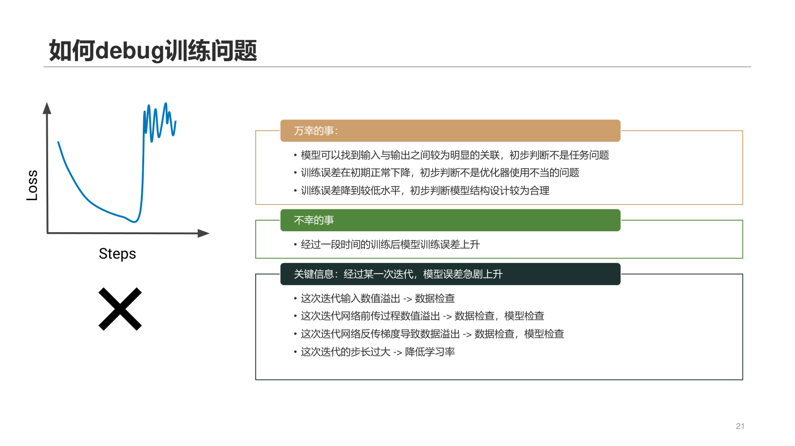
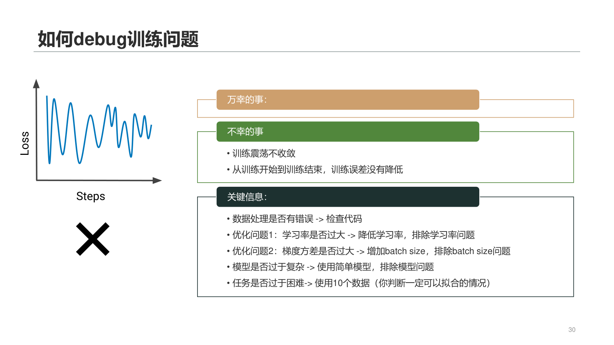
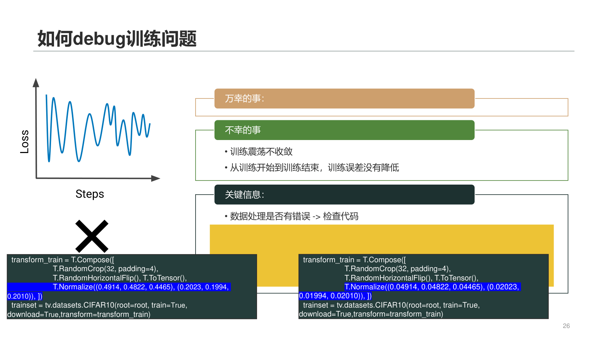
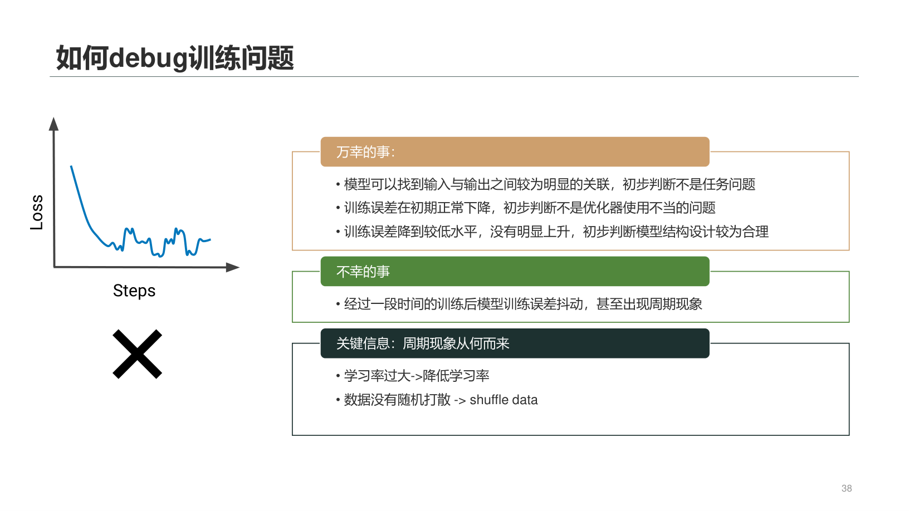
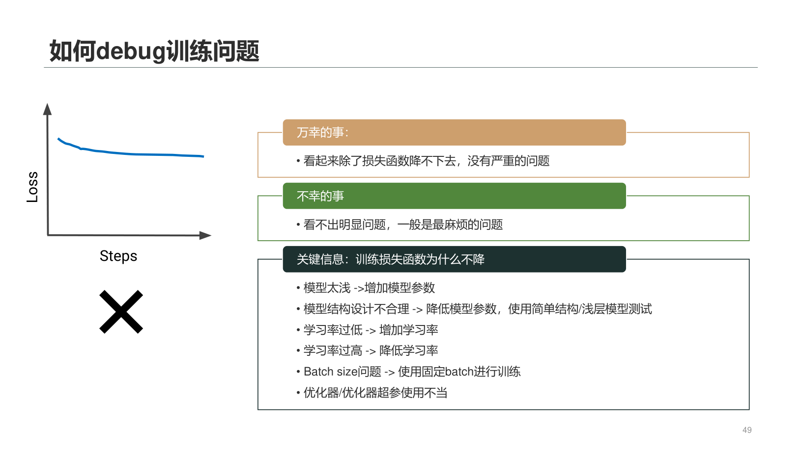
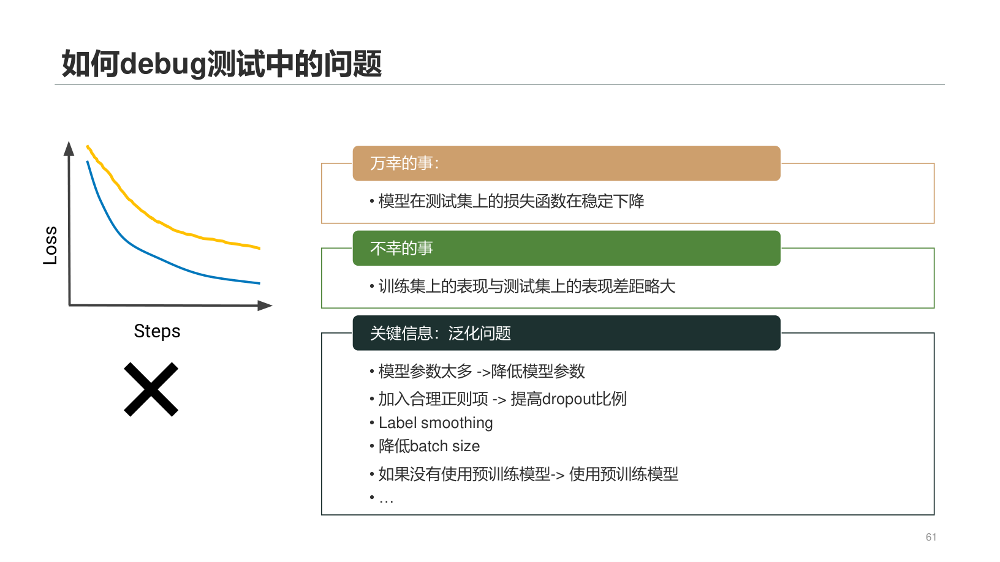
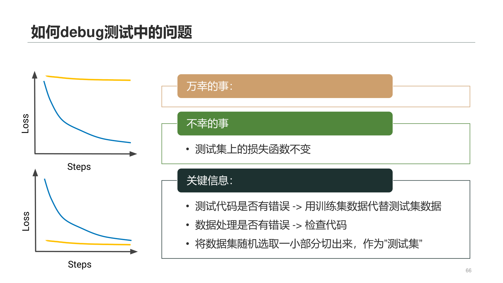
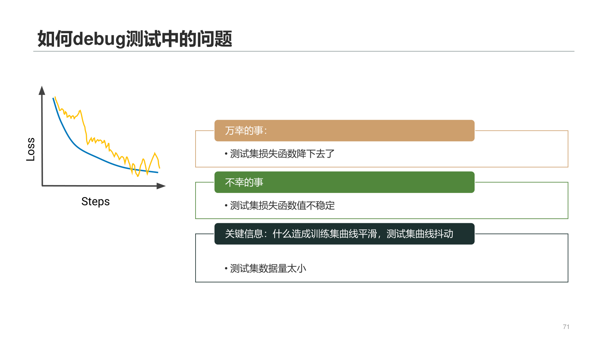

# 第 8 章　深度学习训练与评测调试

本章不是“看到某种曲线就换一个超参数”的经验清单，而是从现象出发，区分数据、数值、优化、容量和评测管线的问题。核心原则是：**曲线给线索，受控实验才定位原因；先让最小系统正常，再增加复杂性。**

来源：教学网《Debugging》，PDF 72 页。课件大量使用逐条揭示动画，下文按完整主题合并；原始曲线是教学示意，不是本笔记运行得到的实验结果。“补充解释”用于说明数学关系与可执行检查，不代表课件报告了额外实验。

## 1. 从可靠基线开始（第 2—8 页）

研究工作的常见流程是：寻找可靠实现 → 围绕研究问题修改 → 检查修改是否有效。课件举了 fairseq 与 BERT 基础模型作为既有代码来源的例子。可修改的部分包括网络结构、损失函数、下游任务、优化算法；一次改很多处后出现问题，很难判断原因。

深度学习调试困难有三个层面：

1. 网络复杂，内部表示不容易直接解释，输出错误无法总是反推到某一层。
2. 超参数多，深度、宽度、学习率、batch size、优化器和 dropout 之间存在相互影响。
3. 目标非凸，一般不能依赖“优化算法必然找到全局最优”的保证来排除训练故障。

这不意味着只能盲目调参。应先复现原始基线，在同一数据、相同处理流程下只改变一个因素，并保留配置与检查点。

**补充解释：最小可复现记录。** 至少保存代码版本、模型配置、数据划分身份、预处理、随机种子、优化器、实际学习率、有效 batch size、损失定义和评测方法。数据随机性与非确定性算子可能使同一设置也产生波动，因此“单次变好”不能自动证明改动有效。

## 2. 先区分训练故障与评测故障（第 9—11、50—52 页）

训练 loss 不下降，优先检查模型是否学得动；训练正常而验证表现异常，则优先考虑评测管线、分布差异或泛化。两类问题的处理顺序不同。

下文把课件用于调参观察的“测试曲线”称作**验证曲线**。严格实验中，最终测试集不应用于反复选择模型或超参数，否则会把测试信息泄漏进开发过程。

**补充解释：先确认比较的是同一种量。** 训练 loss 可能带 dropout、数据增强、正则项，验证 loss 则不带；训练曲线可能是当前 batch，验证曲线是全量平均。若统计口径不同，两条线的差距不能直接解释为泛化误差。先统一基础数据损失与聚合方式，再分析趋势。

## 3. 训练先下降，随后突然爆炸（第 12—21 页）

曲线前半段正常下降，之后突然跳到很高的位置并剧烈震荡。

### 3.1 已经知道什么

早期能够下降，说明在那些步骤中输入与目标至少存在可利用关系，梯度和参数更新曾经起作用，模型也有一定拟合能力。这能缩小范围，但不能证明整个数据管线永远正确，更不能排除后面才出现的异常样本。

### 3.2 优先检查什么

- 出问题的特定迭代是否遇到异常输入、极端值、非法标签或损坏样本。
- 前向传播中是否出现溢出、无穷大或 NaN。
- 反向传播的梯度是否异常放大。
- 参数更新是否过大，例如学习率太高。

**补充解释：定位第一个异常，而不是最后一个。** 记录问题前一批与当前批的数据身份及统计量，比较输入、关键层输出、loss、梯度、参数更新的有限性。loss 为 NaN 往往是较早的算子已经出错，最后一层只是传播了错误。

设更新为 $\theta_{t+1}=\theta_t-\eta_t g_t$，则

$$
\|\Delta\theta_t\|=\eta_t\|g_t\|
$$

对普通 SGD 成立。学习率大或梯度大都能产生大步长；自适应优化器还取决于动量和二阶统计，不能只看原始梯度范数。

### 3.3 怎样验证假设

从最后正常的检查点重放同一个问题 batch。若单独重放也失败，检查该输入与算子；若仅在连续训练后失败，检查优化器状态与调度。降低学习率是一项候选验证，不能代替修复除零、非法对数或错误数据。

本笔记没有执行重放或训练，以上是诊断方案，不是已定位到某个真实 bug 的报告。

## 4. 从头到尾震荡，训练误差不降（第 22—30 页）

这种现象不同于“学了一段时间后崩溃”：模型从一开始就没有呈现稳定学习趋势。课件按以下方向排查：预处理、过大学习率、梯度方差、模型复杂度、任务是否过难。

### 4.1 预处理错误：归一化小数点的例子

课件左侧是均值 $(0.4914,0.4822,0.4465)$、标准差 $(0.2023,0.1994,0.2010)$；右侧把它们都错误缩小了十倍。归一化为

$$
z_c=\frac{x_c-\mu_c}{\sigma_c}.
$$

不能因为均值与标准差“同时缩小”就认为结果不变：输入 $x_c$ 并没有同步缩小。若采用错误常数，

$$
z'_c=\frac{x_c-\mu_c/10}{\sigma_c/10}
=\frac{10x_c-\mu_c}{\sigma_c}.
$$

**补充算例。** 第一通道取 $x=0.5$，正常结果约为 $0.0425$；错误结果约为 $22.2867$。输入分布因此大幅偏移，预训练权重预期的尺度被破坏。实际检查还应核对像素范围是 $[0,1]$ 还是 $[0,255]$、通道顺序、数据类型、训练和评测是否一致。

### 4.2 优化问题：大步长与高方差要分开

学习率过大时，更新在较好区域附近来回越过；减小学习率是一项合理试验。梯度方差较大时，增加 batch size 可能使估计更平稳。

**补充解释。** 若样本梯度独立且同分布，batch 平均梯度的方差随 $1/B$ 缩小。这是理想化关系；有相关性、不同采样、数据增强或改变学习率后，实际训练不一定按此比例改善。有效 batch size 与设备上单次 microbatch 也不同，梯度累积会改变前者。

### 4.3 把任务缩小到能否记住十个样本

课件建议选约十个明显可拟合样本：若连这点数据都学不动，应先检查标签对应、损失、梯度和优化设置，而不是立即追求大规模泛化。

“十个样本过拟合测试”的目的是验证管线能学，不是报告泛化能力。诊断时可以简化模型、去掉妨碍记忆的强增强或正则，但正式实验必须恢复并记录配置。若能拟合十个样本而全量仍学不动，再检查数据多样性、标签噪声、规模变化与优化困难。

## 5. 训练已明显下降，但后期有周期波动（第 31—38 页）

这里早期训练有效，问题更像低 loss 区域中的不稳定，而不是完全无法学习。课件给出两个重点线索：

1. 学习率过大：在较好区域附近反复跳过，可以尝试降低学习率。
2. 数据没有充分打乱：固定顺序的批次难度或类别分布不同，容易形成有规律的波动，检查 shuffle。

**补充解释：检查周期与事件是否对齐。** 若尖峰周期接近一个 epoch，先看是否每轮固定位置遇到同一类难样本；若与学习率重启同步，则检查调度。还需区分单 batch 噪声与全量训练损失。如果平滑曲线才显出周期，保留原始曲线避免平滑造成错觉。

周期并不直接证明“忘记 shuffle”。随机打乱之后波动是否消失，才是支持该假设的证据。涉及时间序列或有序任务时，也不能不顾任务定义强行随机打乱内部顺序。

## 6. 曲线平稳，但停在较高平台（第 39—49 页）

平稳不等于训练成功。这里至少要区分“模型表达不了”与“优化没找到”。课件列出的候选原因包括模型过浅、结构不合适、学习率太低或太高、固定 batch 相关设置，以及优化器配置误用。

### 6.1 为什么既可能要加模型，也可能要减模型

容量不足时，更深或更多参数能表达原模型无法拟合的关系；但结构过复杂、优化困难时，简化可能更易训练。这两种建议针对不同原因，不能作为互相替代的万能操作。

先做小数据拟合和可靠基线比较。如果小模型能下降而复杂模型不能，优先检查优化路径、初始化和架构实现；如果两者都稳定训练，但小模型训练误差长期高，则容量不足更值得考虑。课件用大模型收敛现象与残差学习图示说明结构和规模会改变可训练性，而不是证明“越大永远越好”。

### 6.2 学习率太小与太大都可能表现为平台

太小时，参数移动很慢；太大时，可能只能在某个区域附近振荡，平均曲线看起来不再下降。应查看原始 batch loss、更新量与学习率，而不是仅凭一条平滑线选择方向。

**补充解释：单变量对照。** 在相同起点和短预算下比较几个学习率，保持其他配置相同；观察训练误差与更新量。对优化器核对参数是否进入正确参数组、是否在训练中更新、何时清梯度、何时 step、是否意外冻结。这里是通用核查补充，不声称课件已经给出这些错误的具体案例。

### 6.3 固定 batch 与优化器配置

课件明确建议用固定 batch 训练来排除 batch 相关因素：暂时去掉每步样本变化，观察同一批数据能否被拟合。还要核对优化器的超参数与使用方式，而不是只核对其名称。补充检查包括正式训练的迭代器是否正常推进、batch size 是否符合预期。

需要区分故意固定小 batch 的诊断实验与正式全数据训练：前者用于验证能否拟合，后者若意外固定，则是数据遍历错误。平台损失是否真的“过高”还取决于任务噪声、标签平滑和损失定义，不能一概要求所有 loss 都达到零。

## 7. 训练与验证都下降，但差距很大（第 53—61 页）

好消息是训练有效，验证也在改善；问题是泛化差距较大。课件给出的干预包括减小模型、增加正则或 dropout、label smoothing、减小 batch size，以及从头训练改用预训练模型。

### 7.1 先排除口径和分布差异

先确认两种 loss 可比较、训练与验证预处理一致，且没有意外更换标签映射或数据分布。如果验证集本来来自更难的分布，差距不能完全归因于过拟合。

### 7.2 每种方法改变了什么

- **减小模型**：限制拟合训练集偶然细节的能力，但也可能加重欠拟合。
- **正则与 dropout**：抑制过度依赖特定参数或特征；强度过大会损害训练。
- **标签平滑**：减少极端置信度；它改变目标分布和 loss 下界，因此不能直接和原先硬标签 loss 作数值对照。
- **较小 batch**：可能改变优化噪声与泛化，但收益并非必然，且通常改变效率与调参需求。
- **预训练**：利用先验表示减少有限标签下从头学习的难度，同时要确认领域、输入处理和任务头是否匹配。

**补充公式：标签平滑。** 对 $C$ 类问题，可采用

$$
\widetilde y_k=(1-\alpha)\mathbf1[k=y]+\frac{\alpha}{C},
\qquad\mathcal L=-\sum_{k=1}^{C}\widetilde y_k\log p_k.
$$

这是把平滑质量分给全部类别的约定；也存在只分给非目标类别的约定，实现时应核对库定义。最终选择应由固定验证集指标支持，不可只看训练 loss 更大就认为“正则起效”。

## 8. 训练下降，验证完全不变（第 62—66 页）

优先检查评测代码和数据处理，而不是直接下结论“模型泛化能力差”。课件提出：将训练数据送入测试管线，检查数据处理，或从数据中随机抽出小部分作为诊断验证集。

### 8.1 训练数据走评测管线

若训练程序显示低损失，而同一批训练样本经过评测程序却显示很高或不变的损失，两套管线之间可能有差异。应核对模型检查点、tokenizer 或归一化、标签编号、损失掩码和输出解释。

**补充解释。** 同时检查是否真的载入最新参数，是否正确设置 eval 模式，是否错误复用了旧预测，指标累计器是否清零。训练样本上的评测仅用于诊断一致性，不能包装成测试成绩。

### 8.2 随机小划分的用途与边界

从训练来源随机划分一个小验证集，可以测试原验证集的分布或处理方式是否特别异常。但应按样本主体或任务约束划分，避免同一对象、相邻片段或重复样本跨集合泄漏。

若重新划分后能验证，不代表原测试集应该被忽略；这提示需要解释分布差异。最终仍应回到预先定义、没有参与调参的评测协议。

## 9. 验证在下降，但波动明显（第 67—71 页）

课件指出一个重要原因：验证集太小，观测到的统计量方差较大。验证曲线不平滑并不自动意味着训练不稳定。

**补充解释：估计误差。** 对独立样本，平均损失标准误差约为 $\widehat\sigma/\sqrt n$；二元正确率可用 $\sqrt{\widehat p(1-\widehat p)/n}$ 作粗略尺度估计。小样本、相关样本或极端比例时，这种近似应谨慎使用。增大有效评测样本量、固定评测集合有助于区分噪声与真实变化。

还应检查评测是否保留随机增强或 dropout、每次是否只抽了不同小子集、是否按样本数正确加权。不同大小 batch 的 loss 简单等权平均，可能让最后一个小 batch 权重过高。

不应把一个噪声最低点当成确定改进。对差距较小的模型，应报告重复评测或不确定性；若评测协议必须固定，不能只为了曲线好看随意删掉困难样本。

## 10. 可执行的调试顺序

以下是对课件方法的综合，不是已完成实验的记录。

1. **复现可靠基线**：确认数据划分与预处理，先运行最少改动版本。
2. **检查单批输入输出**：形状、范围、标签对应、loss 有限性。
3. **检查参数确实变化**：正确反向传播，优化器包含需要训练的参数。
4. **拟合约十个样本**：暂时简化干扰因素；失败则先修管线，成功才扩大。
5. **观察训练曲线类型**：从头震荡、突然爆炸、后期周期、平稳平台分别排查。
6. **核对评测一致性**：让同一训练样本走评测流程，排除口径与检查点问题。
7. **再处理泛化**：模型容量、正则、预训练、数据规模与分布。
8. **一次验证一个假设**：记录改动、预期现象、实际结果与是否支持假设。

### 10.1 记录模板

- 现象：在哪一步出现、哪条曲线异常、能否重复。
- 假设：例如归一化尺度错误或固定数据顺序，避免仅写“效果不好”。
- 对照：保持哪些变量不变，只改变什么。
- 判断依据：异常是否消失，训练与验证各发生什么变化。
- 结论：支持、反对或证据不足；不能把没有验证的猜测写成原因。

### 10.2 常见误判

- “loss 在降，所以数据完全没问题”：只能说明当前目标可以被优化。
- “曲线很平滑，所以模型正常”：高平台也可能是严重欠拟合或更新失效。
- “增加参数与减少参数都被推荐，所以随便试”：两者针对不同原因，需先诊断。
- “训练数据评测很好，所以测试成功”：这是管线检查，不是独立泛化评估。
- “最后一次验证分数最高，所以模型最好”：小验证集和重复选择都会放大偶然性。

本章应记住的不是某条曲线对应唯一处方，而是**用尽可能小、可复现的试验，把候选原因逐个排除**。

---

仅用于课程学习。图像来自课件标注页；图26的局部遮挡是原课件动画设计，归一化代码对照完整可见，其余曲线采用最终揭示页。来源、哈希与逐页覆盖见本批次 `SOURCE-COVERAGE.md`。
